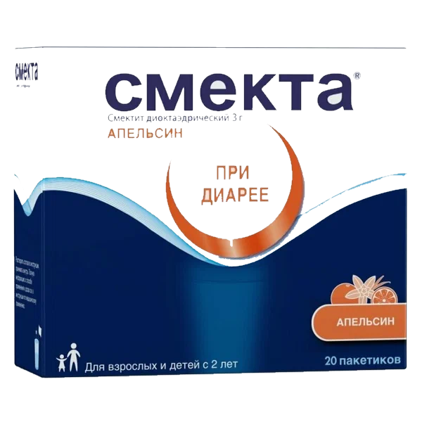

<div align="center">



# 🛡️ Smekta

**Альтернативно-исторический мод для Hearts of Iron IV**

Когда привычный мир трещит по швам, на карту выходит **Смекта** — союз стран, идей и людей, которым есть что делить и что защищать.

[](https://store.steampowered.com/app/394360/Hearts_of_Iron_IV/)
[](https://steamcommunity.com/sharedfiles/filedetails/?id=3329420560)
[](https://github.com/SaberFromFate/SuperSmekta/tree/test)
[](https://github.com/SaberFromFate/SuperSmekta/commits/test)

</div>

---

## 📜 О моде

**Smekta** — большой альтернативно-исторический мод, который перекраивает привычную политическую картину мира HOI4: новые страны и идеологии, собственные деревья фокусов, события, новостные цепочки, персонажи, флаги, портреты, музыка и переработанная карта.

В центре внимания — **Альянс «Смекта»** и его основатели, вокруг которых строится политика, дипломатия и локальные конфликты. Здесь у каждой страны есть свой характер, а у каждого решения — последствия.

> [!NOTE]
> Мод создаётся небольшой командой и активно допиливается. Ветка `test` — рабочая площадка для проверки новых изменений перед стабильным релизом.

---

## ✨ Особенности

- 🌍 **Новый политический ландшафт** — переработанные страны, границы и стартовые ситуации.
- 🏛️ **Собственные идеологии и формы правления** — со своими бонусами, ограничениями и флейвором.
- 🌳 **Уникальные деревья национальных фокусов** — десятки веток на выбор, с альтернативными путями развития.
- 📰 **События и новостные цепочки** — локальные кризисы, разборки, союзы и предательства.
- 🎖️ **Персонажи, лидеры и советники** — колоритные фигуры с собственными чертами.
- 🗺️ **Изменённая карта** — актуализированные штаты, границы и стартовые владения.
- 🎵 **Собственный саундтрек и радиостанция** — авторская музыка и отдельный канал в музыкальном плеере.
- 🖼️ **Кастомный арт** — флаги, портреты, иконки фокусов и интерфейсные элементы.

---

## 🎮 Совместимость

| Параметр | Значение |
| --- | --- |
| Версия игры | **Hearts of Iron IV 1.20.x** (Operation Postern / To the Bitter End) |
| Тип мода | Глобальная альтернативная история / total conversion |
| Язык | Русский (основной), присутствуют файлы других локализаций |
| DLC | Не требуются, но с DLC-контентом мод дружит лучше |
| Мультиплеер | Не гарантируется: у всех игроков должна быть одинаковая версия мода |

> [!IMPORTANT]
> Мод **несовместим** с другими глобальными переработками карты, фокусов и идеологий. Перед запуском отключите прочие моды, кроме библиотек и косметики.

---

## ⚙️ Установка

### Steam Workshop

1. Откройте [страницу мода в мастерской](https://steamcommunity.com/sharedfiles/filedetails/?id=3329420560).
2. Подпишитесь на мод.
3. Активируйте **Smekta** в лаунчере HOI4 и запустите игру.

### Вручную (для разработки)

1. Склонируйте репозиторий в папку модов:

   ```powershell
   cd "$env:USERPROFILE\Documents\Paradox Interactive\Hearts of Iron IV\mod"
   git clone https://github.com/SaberFromFate/SuperSmekta.git Smekta
   ```

2. Создайте рядом файл `Smekta.mod`:

   ```text
   version="1.20.0"
   tags={
       "Alternative History"
       "Events"
       "Map"
       "National Focuses"
       "Sound"
   }
   name="Smekta"
   picture="600x600.png"
   supported_version="1.20.*"
   path="C:/Users/<ВАШ_ПОЛЬЗОВАТЕЛЬ>/Documents/Paradox Interactive/Hearts of Iron IV/mod/Smekta"
   remote_file_id="3329420560"
   ```

3. Запустите лаунчер, включите мод и нажмите **Play**.

---

## 🧱 Структура репозитория

```text
SuperSmekta/
├── common/          # идеологии, идеи, фокусы, решения, технологии, страны, здания
├── decisions/       # решения (старый формат, если используется)
├── events/          # события и новостные цепочки
├── gfx/             # флаги, портреты, иконки, арт фокусов
├── history/         # история стран, юнитов и штатов
├── interface/       # .gui/.gfx: интерфейс, музыкальный плеер, радио
├── localisation/    # локализация (ru и другие языки)
├── music/           # саундтрек, плейлисты и радиостанция
├── portraits/       # портреты персонажей
├── sad/             # служебные/вспомогательные данные
├── descriptor.mod   # метаданные мода
└── 600x600.png      # обложка для Workshop
```

---

## 🛠️ Разработка и тестирование

### Запуск с логами

Самый полезный режим для отладки — `-debug`:

```powershell
& "D:\Steam\steamapps\common\Hearts of Iron IV\hoi4.exe" -debug
```

Логи игры лежат в:

```text
%USERPROFILE%\Documents\Paradox Interactive\Hearts of Iron IV\logs\
```

В первую очередь смотрите:

- `error.log` — ошибки скриптов, локализации, событий и целей;
- `game.log` — ход загрузки и запуска партии;
- `system_debug.log` — ошибки интерфейса и вёрстки.

### Автоматический прогон без кликов

HOI4 умеет сама стартовать партию в режиме наблюдателя. Это удобно для проверки крашей на старте:

```powershell
& "D:\Steam\steamapps\common\Hearts of Iron IV\hoi4.exe" -hands_off -debug
```

Если игра доживает до нескольких игровых месяцев и не создаёт новую папку в `crashes/` — базовый старт стабилен.

### Правила контрибьютинга

- Одна логическая правка — один коммит.
- Не коммитьте временные файлы, бэкапы и `.bak`, если они не нужны проекту.
- Новые теги стран добавляйте в `common/country_tags/`.
- Все новые фокусы, идеи и события должны иметь локализацию.
- После правок проверяйте `error.log` на новые ошибки.

---

## 🩹 Что нового в 1.20

В этой ветке мод адаптирован под **HOI4 1.20**:

- восстановлены отсутствующие ванильные теги стран, из-за которых падала игра при старте;
- обновлены интерфейсные файлы под новые элементы 1.20 (`country_filter`, настройки звука, фракции);
- добавлены GUI-типы для кастомной радиостанции `PUZ_ms`;
- убраны дублирующиеся события и конфликтующие копии ванильных файлов;
- актуализированы штаты и здания под новую карту и контент 1.20;
- обновлён `supported_version` до `1.20.*`.

---

## ⚠️ Известные особенности

- В `error.log` могут оставаться старые предупреждения парсера в устаревших деревьях фокусов — они не приводят к падению игры, но постепенно чистятся.
- Некоторые деревья фокусов содержат дубли ID и неиспользуемые ветки — это наследие старых версий мода.
- Локализация в нескольких языковых папках может быть неполной: основной язык — русский.

---

## 👥 Авторы и ссылки

- **Автор проекта:** [SaberFromFate](https://github.com/SaberFromFate)
- **Steam Workshop:** [Smekta](https://steamcommunity.com/sharedfiles/filedetails/?id=3329420560)
- **Репозиторий:** [SaberFromFate/SuperSmekta](https://github.com/SaberFromFate/SuperSmekta)
- **Ветка разработки:** [`test`](https://github.com/SaberFromFate/SuperSmekta/tree/test)

Отдельное спасибо всем, кто тестировал мод, присылал баг-репорты, музыку, арт и идеи.

---

<div align="center">

**Smekta не одобряет локальные конфликты.**  
Все совпадения с реальными странами, событиями или брендами — художественная условность.

<sub>Hearts of Iron IV © Paradox Interactive. Проект не связан с Paradox и не одобрен компанией.</sub>

</div>
